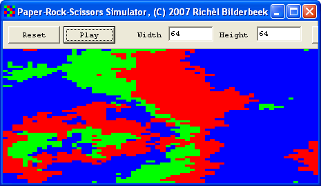

# Paper-Rock-Scissors simulation (VCL)

A paper-rock-scissors simulation.

Paper-Rock-Scissors simulation (VCL) is one of [Richèl Bilderbeek's tools](https://richelbilderbeek.github.io/tools/).

## Links

- [Source code](https://github.com/richelbilderbeek/PaperRockScissorsVcl)
- [Richèl Bilderbeek's tools](https://richelbilderbeek.github.io/tools/)
